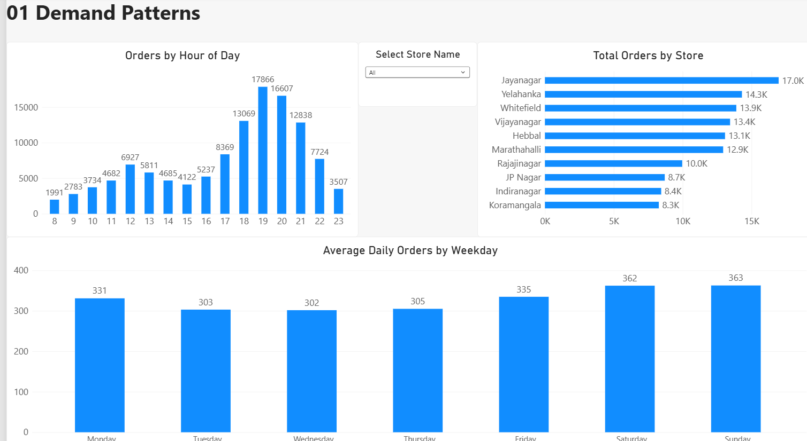
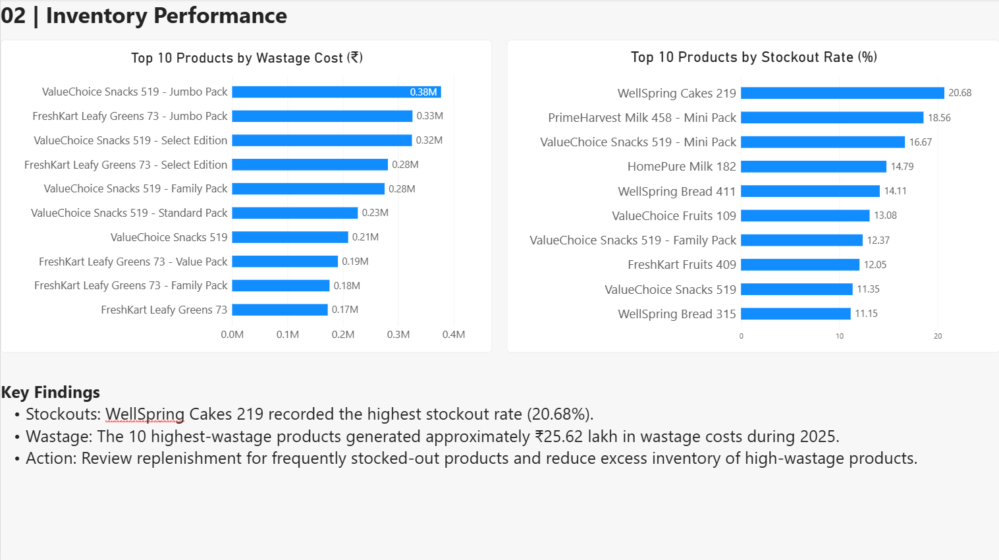
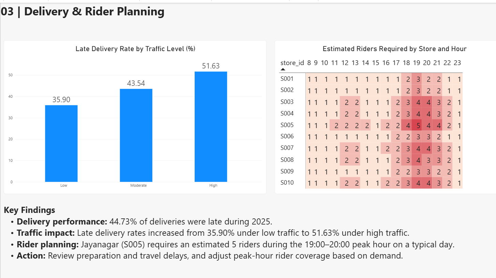
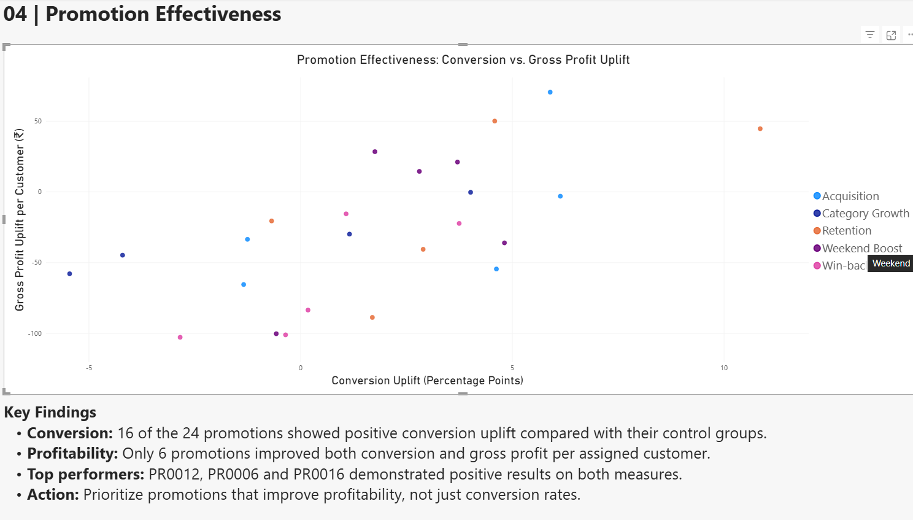

# Bengaluru Quick-Commerce | Decision Science Analysis

**SQL · PostgreSQL · Python · scikit-learn · Power BI**

A portfolio case study using **synthetic 2025 quick-commerce data** covering **120,000 orders, 10 Bengaluru dark stores, inventory, deliveries, promotions and customer purchasing behaviour**. The objective is to turn operational data into practical decisions on demand, inventory, delivery capacity, promotion effectiveness and retention.

## Key findings

| Business question | Finding |
|---|---|
| **1. Demand peaks** | **19:00–20:00** was the busiest hour (17,866 orders); Jayanagar (S005) had the highest order volume. |
| **2. Stockouts** | WellSpring Cakes 219 had the highest observed stockout rate (**20.68%** of store-days). |
| **3. Wastage and overstock** | The top 10 products accounted for approximately **₹25.62 lakh** in 2025 wastage costs; days of stock cover highlighted slow-moving inventory. |
| **4. Late deliveries** | **44.73%** of deliveries were late; the late rate increased from **35.90%** in low traffic to **51.63%** in high traffic. |
| **5. Rider capacity** | A typical **19:00–20:00** hour at Jayanagar requires an estimated **5 riders**, using assumed productivity and utilization. |
| **6. Promotions** | **16/24** campaigns had positive conversion differences versus controls; only **6/24** had positive differences in *both* conversion and gross profit per assigned customer. |
| **7. Customer inactivity** | A logistic regression churn-risk model achieved **0.759 ROC-AUC**, **64.6% recall** and **32.8% precision** on a held-out test set. It flagged **2,979** of 8,285 eligible customers at year-end. |
| **8. Next-week actions** | Review peak-hour rider coverage, address preparation/travel delays, target stockouts and wastage, prefer profitable promotions, and pilot low-cost retention outreach. |

## Power BI report

### Demand patterns

### Inventory performance

### Delivery and rider planning

### Promotion effectiveness

## Approach and files

- **SQL / PostgreSQL:** data preparation, integrity checks, joins, aggregations and reporting views — [`4_exploratory_analysis.sql`](4_exploratory_analysis.sql).
- **Python:** customer recency/frequency/monetary features, historical churn labels, logistic regression, validation-selected decision threshold and year-end scoring — [`5_customer_retention.ipynb`](5_customer_retention.ipynb).
- **Power BI:** four report pages exploring demand, stockouts/wastage, delivery/rider planning and promotions — [`quick_commerce_report.pbip`](quick_commerce_report.pbip). The accompanying `.Report` and `.SemanticModel` folders are required to open the project.

## Interpretation and limitations

This is **synthetic data**, not a live operational deployment. Delivery associations are not proof of causality; rider estimates assume **2 deliveries per rider-hour at 80% utilization**. Promotion comparisons are observational unless assignment randomization can be verified. Churn means **no completed order in a defined three-month observation window**, not permanent loss; model probabilities are not independently calibrated, and 2026 outcomes are not available for verification. The Power BI project uses a local PostgreSQL connection and may require connection configuration to refresh.
